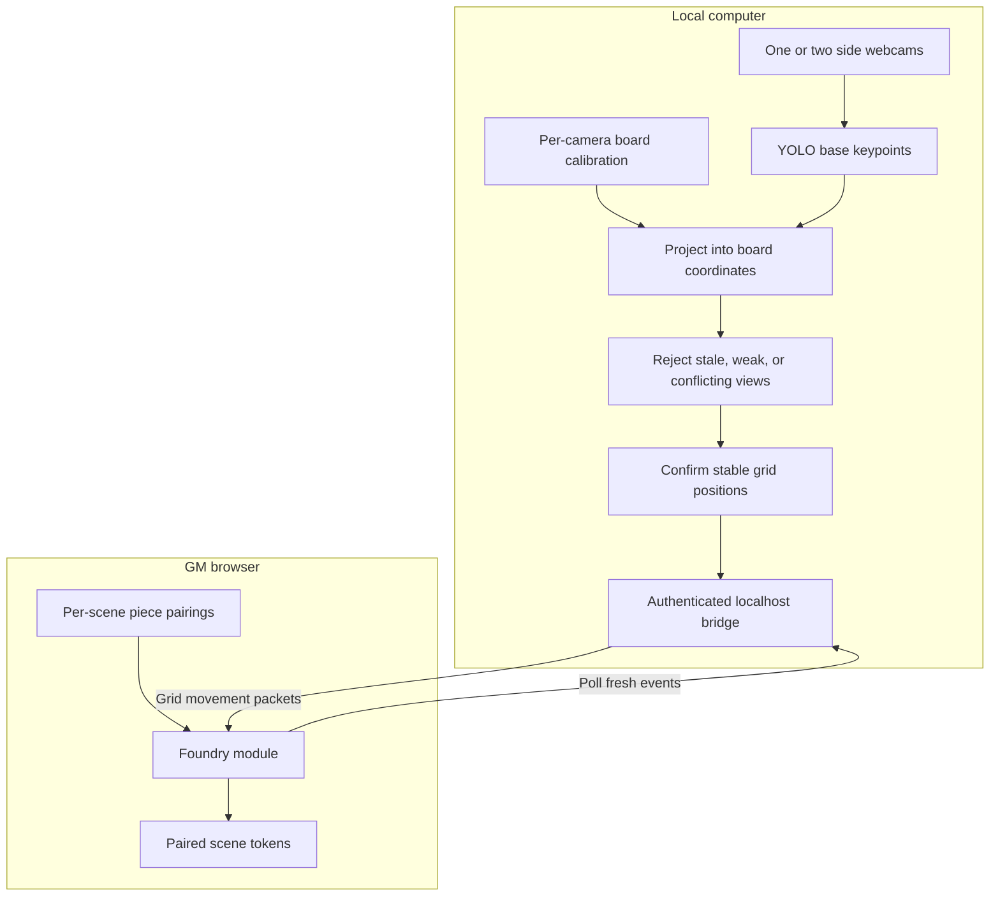

# Game Token Tracking

Track tabletop miniatures with ordinary, unmounted consumer webcams placed beside the table, and synchronize confirmed grid positions to manually paired Foundry VTT tokens.

**Status:** software prototype with one/two-camera tracking, dataset tooling, and a Foundry v13 module. No trained miniature weights or measured camera-to-Foundry accuracy/latency are included. The first model uses a fixed inventory of visually distinct pieces.

## Architecture at a glance



Two independent planar views improve visibility; this is not stereo triangulation. A hidden base and an identical piece remain sources of ambiguity.

## Start here

| Goal | Guide |
|---|---|
| Understand components, geometry, and design decisions | [Architecture](docs/architecture.md) |
| Prove token movement before training | [Foundry setup](docs/foundry-setup.md) |
| Capture, label, train, calibrate, and run cameras | [Prototype walkthrough](docs/prototype-walkthrough.md) |
| Configure cameras and thresholds | [Configuration reference](docs/configuration.md) |
| Integrate with the local service | [Bridge protocol](docs/bridge-protocol.md) |
| Diagnose setup or tracking failures | [Troubleshooting](docs/troubleshooting.md) |
| Plan and record acceptance testing | [Validation plan](docs/validation.md) |

## Install

Run from the repository root. Python 3.10+ is required; Node 22 is used for the JavaScript checks.

```powershell
git clone https://github.com/Shad0wMazt3r/game-token-tracking.git
cd game-token-tracking
python -m venv .venv
.venv\Scripts\Activate.ps1
python -m pip install -e ".[yolo]"
```

On Linux/macOS activate with `source .venv/bin/activate`. For bridge work and Python checks, `python -m pip install -e .` avoids the optional YOLO dependency. A desktop session is required for OpenCV capture/labeling windows.

## Run

First follow the Foundry guide's manual movement test. Once custom weights and calibration files exist, edit [examples/session.json](examples/session.json):

```powershell
python -m token_tracker.session examples/session.json --log moves.jsonl
```

Set `bridge` to `null` for vision-only testing. Space pauses, G toggles the grid, R clears confirmed positions so stable observations can be emitted again, and Esc exits.

## Developer checks

```powershell
python -m unittest discover -s tests -v
node --test tests/foundry/core.test.mjs tests/foundry/module.test.mjs
```

[Windows/Linux CI](.github/workflows/test.yml) checks software behavior. It does not establish live webcam or Foundry compatibility. See the validation plan for evidence needed before making accuracy claims.

## Scope and limits

- Each distinct physical piece has its own model class; adding pieces requires retraining.
- Duplicate class detections are withheld. Identical pieces cannot reliably retain identity through complete occlusion.
- Calibration applies to the board plane. Body centers and elevated keypoints introduce position errors.
- Missing, ambiguous, and off-board observations preserve the last confirmed digital position.
- Foundry support targets v13, square grids, one GM browser, and positional synchronization. Walls and game-system movement rules are not enforced.
- The 95% grid-square goal and p50 below 500 ms remain unmeasured targets.

No recordings, private bridge keys, or trained weights should be committed.
