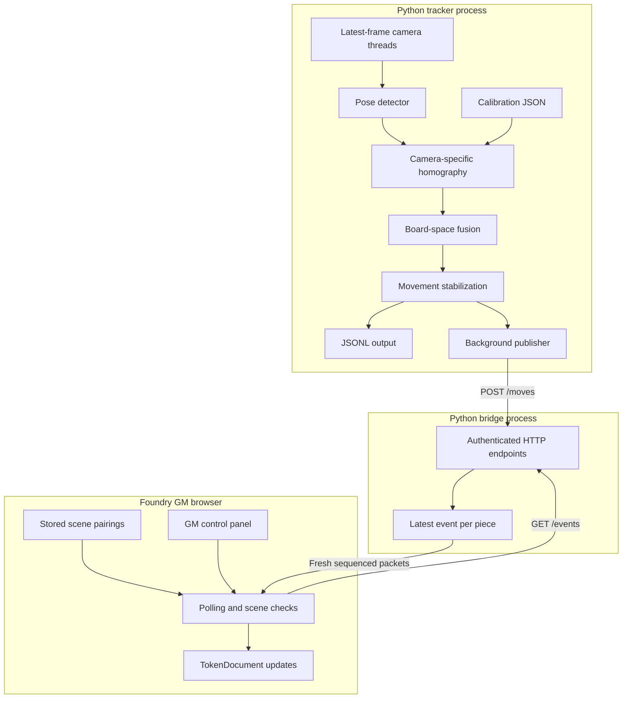
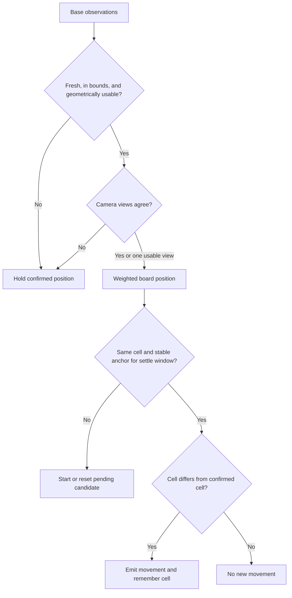
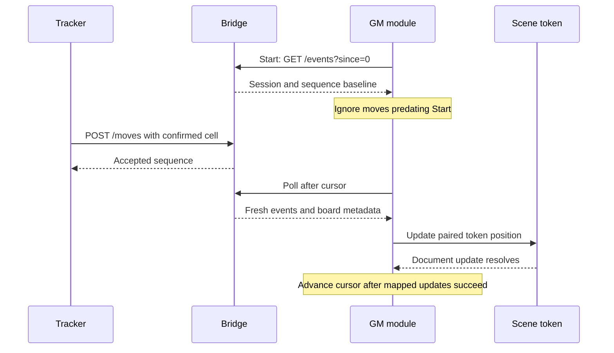

# Architecture

[Documentation home](../README.md) · [Configuration](configuration.md) · [Protocol](bridge-protocol.md)

## System boundary

The optional [dashboard](dashboard.md) now hosts the bridge and a local browser control surface in one Python process. Simulation publishes directly to that bridge; camera mode and synthetic observation replay share `pipeline.py`. The existing CLI session remains available. Foundry's GM panel reports successful document applications; the dashboard reports bridge acceptance separately.

The physical board is observed by one or two fixed consumer webcams resting beside the table. Python performs inference and board-space processing locally. A separate HTTP bridge exposes fresh positions to the GM's Foundry browser, which applies updates using the GM's existing permissions. Python does not authenticate to Foundry.

The Foundry server may be elsewhere, but the bridge must run on the GM browser's computer: `127.0.0.1` refers to that computer.

## Component ownership

| Source | Responsibility |
|---|---|
| `token_tracker/dashboard.py` and `token_tracker/web/` | Local control service, simulation board, camera previews/calibration, and runtime status |
| `token_tracker/pipeline.py` | Deterministic fusion/stabilization orchestration for dashboard cameras and replay |
| `token_tracker/replay.py` | Validate and replay board-space snapshots, optionally through HTTP |
| `token_tracker/capture.py` | Background webcam reads; only the latest frame is retained |
| `token_tracker/detector.py` | Custom pose weights; one base point; duplicate-class rejection |
| `token_tracker/calibration.py` | Homography, calibration residual, geometric sensitivity |
| `token_tracker/fusion.py` | Freshness, board bounds, sensitivity, and agreement gates |
| `token_tracker/state.py` | Stable movement confirmation and last confirmed cell |
| `token_tracker/session.py` | One/two-camera live orchestration, overlays, controls, logs |
| `token_tracker/cli.py` | Calibration UI and simpler single-source camera/video tracking |
| `token_tracker/bridge.py` | HTTP service, event retention, asynchronous publisher, manual moves |
| `token_tracker/dataset.py` | Capture, annotation, session-grouped splits, training |
| `token_tracker/evaluate.py` | Match held-out trials to emitted movement events |
| `foundry/game-token-tracking/scripts/core.mjs` | Packet and geometry validation |
| `foundry/game-token-tracking/scripts/module.mjs` | Foundry lifecycle, polling, settings, pairing, token updates |
| `foundry/game-token-tracking/scripts/panel.mjs` | GM configuration and pairing interface |

## Coordinates and geometry

| Space | Convention |
|---|---|
| Camera image | Pixel coordinates of the base center |
| Physical board | Continuous grid units; origin at board top-left; X right, Y down |
| Grid cell | Zero-based `column=floor(x)`, `row=floor(y)` within board bounds |
| Foundry canvas | `x=originX+column*gridSize`, `y=originY+row*gridSize` |

Each camera has its own homography into the same board coordinates. A 12×8 board spans continuous coordinates from (0,0) to (12,8); its last valid cell is (11,7). Calibration references are intersections, not cell centers.

Homography only describes the board plane. Training targets the base center on that plane rather than the center of a miniature's bounding box. Near edge-on views amplify small pixel errors. The sensitivity estimate projects two-pixel offsets; it is not a confidence interval for learned keypoint error. Lens distortion is not corrected by this prototype.

Four non-collinear references establish the mapping; additional spread-out references allow residual consistency checks. A low fitting residual does not establish accuracy at unseen points or outside the calibrated region.

## Observation and movement decisions

Weights use keypoint confidence divided by geometric sensitivity squared plus a small floor. Both camera views are inferred sequentially; capture threads do not synchronize camera exposures. Freshness checks bound age, but do not make observations simultaneous.

Missing observations clear a pending candidate, preserving the last confirmed cell. There is no explicit removed/inactive token state. A held position is not evidence that a piece is still there.

## Movement delivery

The bridge stores the latest event per piece for delivery, with a three-second freshness window. It is not a durable queue or complete move history. A newer move supersedes an older move for that piece. Up to 64 distinct piece IDs can be retained in the bridge's in-memory dictionary; expired entries are not automatically deleted from that dictionary.

Publisher retries and browser retries are bounded by freshness. A bridge restart changes its session ID, allowing the module to reset its cursor. Start establishes a baseline, so resynchronization after a deliberate Stop/Start requires a fresh move, a manual move, or the live tracker's R control.

## Persistence and trust

| Data | Lifetime |
|---|---|
| Weights, calibration, session configuration | Local files |
| Confirmed tracker cells | Tracker process memory |
| Bridge session, sequences, latest events | Bridge process memory |
| Pairings | Foundry world settings, keyed by scene ID |
| Bridge URL/key, target scene, board origin | Foundry client settings |
| Movement logs | Local JSONL when requested |

The bridge binds to loopback, checks bearer authentication, and allows one configured browser origin. Authentication applies to event reads and move writes. CORS is a browser boundary, not a substitute for authentication. The key is masked in the panel, but the underlying settings field is unmasked.

Scene changes and pairing/configuration changes stop tracking. One GM browser should own synchronization; there is no leadership lease for multiple GMs. The adapter does not enforce walls, combat movement allowances, or bidirectional physical synchronization.

## Design decisions and unfinished work

| Decision | Reason | Cost |
|---|---|---|
| Class per distinct physical piece | Simple identity recovery for a constrained first dataset | Retraining for new pieces; identical-piece ambiguity |
| Base keypoint pose model | Localize on the board plane in angled views | Requires precise base labels |
| Independent homographies | No synchronized stereo rig needed | Cannot infer a hidden base through geometry alone |
| Conservative agreement gate | Avoid committing contradictory positions | More held/missed moves |
| Browser-driven Foundry updates | Reuses GM permissions without exporting credentials | Browser networking restrictions and live compatibility testing |
| Latest fresh positions | Bounded latency and no old-motion backlog | No guaranteed delivery through long outages |

Camera-independent board-observation replay is available through `token_tracker.replay`. The dashboard adds a board simulator, camera preview/calibration, runtime diagnostics, and start/pause/resync controls. Automatic camera reconnect, explicit inactive states, reusable appearance profiles, durable event delivery, and complete Foundry acknowledgement timing remain future work. Recorded-video inference in the single-source CLI remains separate from deterministic observation replay.
